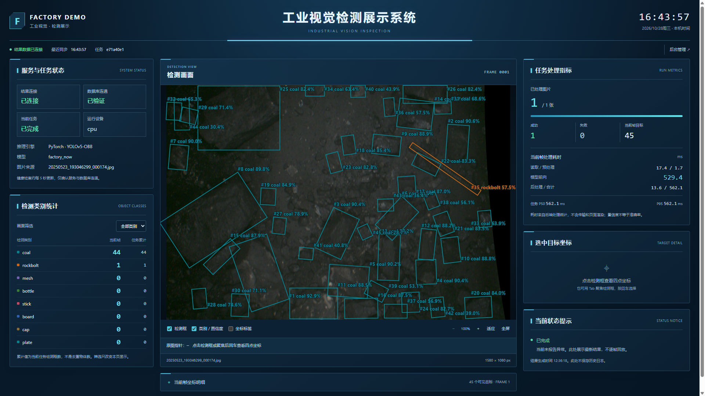

# V1.3 工业展示说明

当前展示采用版本化快照、WS JSON 推送与不可变预览 URL，stream 层完成协议校验/配对/解码，DetectionStage 为纯画布。实时和历史继续共享画布。坐标、中心与有效角度都采用原图像素空间，total=null 的持续来源不显示虚构百分比。详细契约见 [CONTRACT.md](CONTRACT.md)，实现边界见 [V1_3_DECOUPLING.md](V1_3_DECOUPLING.md)。

下面 V1.2 截图和验收是此前工业外观/坐标功能的历史证据；其中“500ms状态轮询”“画布自行取原图”等描述已被 V1.3 替代，不能作为本轮实现说明。

# V1.2 工业视觉检测展示系统

本版采用用户参考图的深蓝工业监控风格：顶部标题、三栏面板、青蓝细边框和真实数值。展示页标题为“工业视觉检测展示系统”，标识为 FACTORY DEMO。后台、阅读手册和教学网页保留浅色阅读风格。

本文定义当前功能与验收条件；浏览器验证证据另行记录，不能把“应当通过”当作“已经测试通过”。

上图来自本轮实际浏览器中的 V1.2 页面，读取已有真实检测记录；本轮没有因截图重新执行推理。选中目标的交互效果见 [四点坐标截图](evidence/industrial-display-selected.png)，窄屏效果见 [手机宽度截图](evidence/industrial-display-mobile.png)。

## 1. 展示与管理入口

展示入口 `/` 只读查询检测结果，后台入口 `/admin.html` 负责上传、任务参数、开始/暂停/继续/停止、历史查询与导出。深色主题只作用于展示页；后台历史仍复用同一个 DetectionStage。

**边界约束**

- 展示筛选、缩放、全屏、框选择和坐标开关仅改变当前浏览器视图；不写数据库、不修改推理参数。
- 页面刷新不创建任务，关闭页面不停止工作线程。后台管理链接打开独立页面。
- 两个入口是职责划分，不是身份鉴权；本版没有新增登录、访问角色或网络部署。
- 画布共享交互功能；展示页深色 CSS 必须限定在 `.display-page` 内，不能污染后台。

## 2. 三栏与屏幕适配

左栏展示服务、数据库和任务状态，以及各类别的当前帧数量和当前任务累计框数；中央保留最大的检测图像区域和可展开坐标明细；右栏展示处理进度、耗时、选中目标和当前状态提示。顶部显示本机时钟与数据连接状态。

**边界约束**

- 面向 1920×1080 桌面，同时检查 1366×768 与窄屏。小窗口允许纵向滚动，不能整体缩小桌面文字来强塞三栏。
- 图片等比显示，不拉伸、不裁改检测点来填满面板。长模型名和文件名应换行或有提示。
- 表格允许局部横向滚动；页面主体不应产生非预期横向滚动。
- 本机时钟不代表服务器时间，也不代表检测结果刚生成；结果新鲜度以成功查询时间和帧时间分别表达。
- 使用本机字体、CSS 与 SVG；不依赖在线字体或图片，不加入持续粒子、扫描或机械动画。

## 3. 服务状态与结果新鲜度

展示读取 `/api/status` 和 `/api/health`，模型与引擎信息取自 Run 快照。状态查询完成后约 500 ms 再查，健康查询完成后约 5 秒再查；两条循环各自只允许一个请求在途。各状态采用文字和颜色共同表达；连接中断保留明确的最后结果标识。

**边界约束**

- 状态接口成功只说明该次查询成功，不能据此把数据库、模型、设备和工厂系统全部标绿。
- 数据库状态必须来自健康接口；模型元数据不等同于一次新的推理成功。
- 首次无数据、模型加载、正在处理、暂停、终态、图像加载失败和连接中断必须可区分。
- 轮询用于读取最新快照，可能跳过中间帧；不承诺逐帧播放，不把它描述成视频流。
- 当前错误提示不是完整事件日志；历史记录继续在后台查询，不在浏览器虚构事件列表。
- 轮询和时钟在组件卸载时清理；慢请求不叠加同类请求。

## 4. 图像、框与坐标一致性

最新接收的 `props.frame` 与已加载的 `loaded` 是不同状态。只有原图字节成功读取、图像解码完成、请求版本仍有效，画布才提交该 Frame。组件通过 `display-change` 通知父页当前可显示帧、选中目标、错误和加载状态，父页据此更新当前帧计数、坐标表与目标详情。

**边界约束**

- 图像、框、当前帧表格和选中详情均绑定同一 `(run_id, frame_id)`。最新 Run 累计统计可以继续更新，但必须明确其“当前任务”口径。
- 新帧加载、图像失败或换任务时清空旧坐标及选择，不在新画面旁保留旧目标详情。
- 帧数据与类别表必须属于同一个任务，不能用新任务的模型元数据解释旧任务画面。
- 请求取消和 revision 校验共同阻止过期图片覆盖新任务；Blob URL 用完释放。
- 没有目标是合法成功帧；图像不可读是失败状态，二者不能共用“0 个目标”来掩盖错误。

## 5. 指针、选择与明细

指针读数常驻图像下方；点击或键盘选择检测框后，显示 P1～P4 和置信度。坐标标签默认关闭，可手动开启；框和类别标签默认保留。完整坐标表可展开查看。

**边界约束**

- 原点为原图左上角，x 向右、y 向下，单位 px；通过 SVG 逆 CTM 将浏览器指针映射回原图。
- 缩放、滚动、全屏、SVG 留白不能改变坐标含义；指针落在原图之外显示空值。
- 预测顶点允许出界，保留原值与顺序；显示一位小数仅改变文字，不修改结果。
- 目标编号只在当前帧有效，不是跨帧追踪身份。切帧、切任务、筛掉选中目标时清除选择。
- 坐标标签关闭不影响指针与选中详情。关闭框、类别筛选均不改变累计统计或模型输出。
- 没有框编辑、拖拽改点、标注保存或 CVAT 功能。

## 6. 类别、进度与性能数值

类别由任务模型元数据提供。当前帧框数来自已加载 Frame，累计框数、成功/失败数量和处理进度来自后端 Run。耗时使用既有 `timing_ms` 与 `Run.timings`，缺失显示“—”。

**边界约束**

- 置信度是模型分数，不是识别准确率；成功处理比例不是检测正确率。
- 累计框数是各图预测实例数的总和，不是实物去重数量，也不是每分钟生产数量。
- `completed` 可以同时存在失败图片，应保留失败数。
- `total` 是读图、预处理、前向和后处理的合计，不包含所有快照、数据库和浏览器耗时。
- 模型前向耗时不称为端到端延迟；`1000 / mean_ms` 不称为画面刷新 FPS。
- 当前没有机器人、抓取准确率、3D 点云、能耗、温度或生产吨数的数据，界面不展示虚构数值。
- 本轮没有实施模型加速，也没有用新界面测量结果替代原有 50 张样本基线。

## 7. 代码与教学对应

| 文件 | 职责 | 教学位置 |
|---|---|---|
| `frontend/src/DisplayApp.vue` | 只读查询、三栏信息、已加载帧与选择联动 | 第 14 课 |
| `frontend/src/display.css` | 限定展示页的深蓝主题和响应式布局 | 第 14 课 |
| `frontend/src/components/DetectionStage.vue` | 图片加载、原图坐标、框选择、display-change | 第 13 课 |
| `frontend/src/AdminApp.vue` | 独立任务和历史管理 | 第 14、15 课 |

教学参考代码同步到独立课程 `reference`；练习 API 8876、开发页面 5176、最小 API 8877 和独立教学数据库保持不变。更新参考答案不会覆盖 `practice` 中已经写过的代码。

## 8. 验收条件与证据边界

检查生产构建、只读请求、真实已存结果显示、坐标变换、选择与筛选、跨帧一致性、错误与断线、桌面和窄屏、后台浅色主题、手册与课程链接。完整测试结果需以实际生成的验证记录为准。

本次界面验证不自动证明新的真实推理、生产速度、全量数据集精度或工业现场稳定性；原 V1 推理证据仍是历史基线。

### 2026-10-28 实际验证结果

[完整验证记录](evidence/industrial-display-validation.json)汇总本轮实际执行的检查：

- Vite 双入口生产构建通过；展示页浏览器请求未出现写操作。
- 已保存的真实检测结果可显示；普通、放大、全屏下的原图指针坐标一致，选中目标与筛选联动通过。
- 浏览器内模拟慢加载、图片404、零目标、无任务和跨任务迟到响应，通过同帧与清空检查；测试没有写入后台记录。
- 断线保留并标记最后结果，恢复后正常更新；后台历史画布保持白色背景和绘框导出入口。
- 1920×1080、1366×768、390×844 检查通过。后两种尺寸允许纵向滚动，均无非预期页面横向溢出。
- 11章手册、5张流程图、20课/37份完整源码教程通过浏览器导航、搜索和窄屏检查；页面无外部资源请求。
- 后端及 AdminApp 源文件哈希未变；9个教学前端参考文件与本项目一致，教学端口和练习区保留。

这些结论对应本次浏览器和构建检查；没有重新运行推理或完整数据集性能测试。
