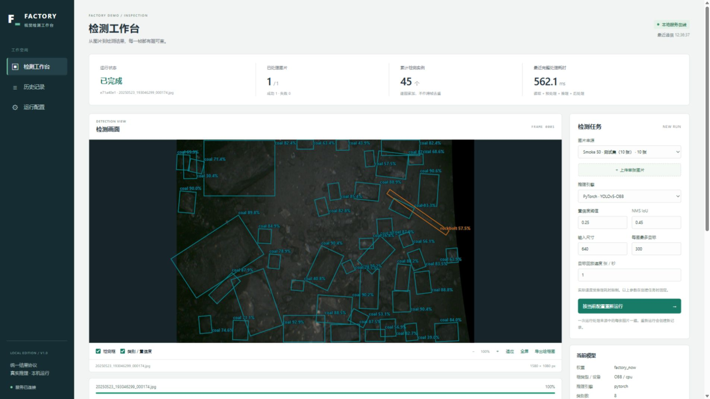

# Factory Demo V1.0 实际验收记录

> **历史证据说明：** 本文测试、性能数字及浅色工作台截图均对应 V1.0，不是 V1.2 工业展示页面的新验收。当前界面职责与边界见 [工业展示说明](INDUSTRIAL_DISPLAY.md)；保留旧图用于追溯原始真实推理流程。

验收日期：2026-10-28（北京时间）。项目位置：`C:\Users\13480\Desktop\codex_\factory_demo`。

## 1. 本次结论与范围

已跑通真实链路：单图/目录图片 → PyTorch YOLOv5-OBB CPU → 原图像素四点框 → PostgreSQL → 浏览器显示/控制/历史 → JSON、CSV、绘框PNG。用户指定50张小数据集全部完成，无图片失败。

OpenVINO/TensorRT 按确认范围只保留统一接入协议及不可用能力信息，没有实现或验证对应推理后端。无CVAT、标注、训练、视频、摄像头、跟踪、实物分拣控制。

## 2. 环境与模型

| 项目 | 实际值 |
|---|---|
| 解释器 | `C:\Users\13480\miniconda3\envs\yolo_v5_obb\python.exe` |
| PyTorch | 2.14.1+cpu（环境中的原版本，未切换CUDA） |
| torchvision / OpenCV | 0.29.1 / 5.0.0.93 |
| 后端 | FastAPI 0.162.0，Uvicorn 0.54.0，psycopg 3.3.6 |
| 前端 | Vue 3.5.42，Vite 6.4.3，plugin-vue 5.2.4 |
| 存储 | 本机 PostgreSQL 17，独立库与非超级用户 `factory_demo` |
| 运行 | CPU，FP32，4线程，batch=1 |
| 权重 | `vendor/weights/factory_now.pt`，87,431,737参数 |
| 权重SHA-256 | `62af01dbc971d332ad4813d5f2811243f555877ffbdb0755fe428159687ef037` |
| 真实类别顺序 | coal, rockbolt, mesh, bottle, stick, board, cap, plate |

完整包版本见 [environment.json](evidence/environment.json)。`pip check` 通过，没有检测到损坏的依赖约束。仅补装了已授权的API、PostgreSQL驱动及测试依赖，未安装OpenVINO/TensorRT。

**权重8类与数据集7类及编号顺序不同。** 前端与导出采用权重类别顺序。本次未作真值匹配，任何框数、置信度或耗时都不是准确率证据。类别映射见 [README](../README.md#4-权重与类别映射)。

## 3. 50张真实HTTP与数据库流程

参数：640输入，confidence=0.25，NMS IoU=0.45，max_det=300，目标回放10张/秒。原train/val/test归属保持，各自独立创建任务。运行时浏览器在线；未进行多轮重复性能实验。

| 子集 | 图片成功/总数 | 预测框数 | 处理均值ms | P50 ms | P95 ms | 处理能力FPS |
|---|---:|---:|---:|---:|---:|---:|
| test | 10/10 | 196 | 434.77 | 427.44 | 466.43 | 2.30 |
| val | 10/10 | 209 | 528.13 | 529.54 | 561.44 | 1.89 |
| train | 30/30 | 819 | 445.71 | 432.55 | 531.41 | 2.24 |

总计50张、1224个预测框，失败0张。测试脚本逐项断言：任务completed、processed=total、failed=0、JSON帧数等于图片数、各帧框数之和等于任务累计、原图与绘框PNG可以通过HTTP读取。

这里处理耗时=读取/解码+预处理+forward+后处理，**排除模型加载/640预热、图片快照落盘、数据库写入、限速等待、网络与页面显示**。FPS=1000/均值，不能视为端到端吞吐或生产性能；P50/P95来自成功帧，NumPy默认线性插值。新尺寸第一帧的额外开销未单独剔除。

证据：[smoke50.json](evidence/smoke50.json)。可复现入口：[scripts/smoke.py](../scripts/smoke.py)。本次创建的运行与图片快照保留，后续完整数据集性能与精度由用户按 [性能指南](PERFORMANCE.md) 另行评估。

## 4. 原detect路径与真实推理测试

适配器在独立进程中与原仓库 `detect.run` 对同一张真实图片进行对比，使用相同权重与参数：45个框的类别、顺序一致，四点坐标最大差0.004981像素，置信度最大差4.884e-7；原TXT使用 `%g` 舍入，差异处于该精度范围。

证据：[detect-parity.json](evidence/detect-parity.json)、[inference-smoke.json](evidence/inference-smoke.json)，具体方法见 [INFERENCE.md](INFERENCE.md)。没有用伪造检测结果替代真实推理验收。

## 5. 自动测试

联合测试结果：**20 passed，5 subtests passed，17.77秒**。其中15项API测试使用真实PostgreSQL的独立临时schema与明确的推理替身，5项推理测试使用真实权重与rotated-NMS；两种证据不混同。

覆盖：

- 逐图提交、类别计数、合法空检测、坏图失败记录、JSON/CSV与绘框PNG。
- 原输入修改后仍能读取历史快照；创建后变更图片被标为失败；空目录拒绝。
- 暂停/继续/停止、重复控制幂等、同时启动第二任务409、终态重新运行创建新ID。
- 参数上下界、32倍数、非法源、未实现引擎、额外请求字段。
- 中文文件名单图上传、伪图片、不支持格式、跨站写请求拒绝、分页上限和不存在资源。
- 无Content-Length的大型multipart请求在接收层被413拒绝。
- 数据库单实例锁、中断任务恢复并保留已保存帧。
- 权重类别顺序、元数据拷贝隔离、空检测输出、非法参数、真实旋转NMS抑制。

日志：[pytest-final.log](evidence/pytest-final.log)。6条警告来自旧YOLO依赖的pkg_resources/distutils弃用，以及Starlette测试客户端的httpx弃用提示；没有测试失败。未为消除弃用警告替换原模型环境。

## 6. V1.0 浏览器操作与历史截图

使用Codex内置浏览器完成以下实际操作：

- 真实目录任务启动并显示旋转框；动态8类和模型信息显示。
- 慢速任务暂停到paused、继续、停止；停止时当前帧完成后记录为stopped。
- 按rockbolt筛选，当前帧无该类时显示“当前筛选下无目标”，累计统计不变。
- 打开历史列表与逐图详情，JSON按钮下载成功；下载文件与API导出对应。
- 通过文件选择器上传真实测试图片，任务1/1成功，45个框。
- 放大到125%及适应窗口；切换配置页，OpenVINO/TensorRT明确显示未接入。
- 刷新最新生产构建，确认SVG使用同一Blob图像并叠加45个四点框，最终页面无控制台error。
- 1920×1080、1280×720、800×900的实际渲染检查：文档宽度分别为1905、1265、785像素，均无页面横向溢出；小窗口通过纵向滚动访问全部内容。
- 点击全屏和返回普通画面可操作；原生全屏与内置浏览器虚拟viewport的组合未作为跨浏览器像素级验收，普通桌面窗口为主要验收基准。

截图：[1920工作台](evidence/workbench-1920.png)、[1280工作台](evidence/workbench-1280.png)、[800宽窗口](evidence/workbench-800.png)。

## 7. 服务进程中断与恢复

启动测试任务 `a8a119cd-ba81-4f8a-a3f6-0db225c8667f`，首帧保存后，仅终止本次创建的Factory Demo进程，未重启PostgreSQL或其他项目服务。页面显示连接断开，禁用控制并标记旧结果。重启应用后：任务状态为interrupted，processed=1，45个检测框和图片快照仍保留；未自动重新执行任务。

证据：[restart-result.json](evidence/restart-result.json)。最终服务随后正常完成一张真实上传图片的演示任务。历史中保留的stopped/interrupted记录来自上述边界验收，不代表50张验收失败。

## 8. 未验证和运行限制

- `GUIDE.html` 已生成并完成本地HTML结构/链接检查。内置浏览器只允许HTTP/HTTPS，拒绝file协议预览，因此没有声称本地双击打开的渲染已验收；工作台网页的实际渲染检查已单独完成。
- 未运行完整数据集、未训练、未计算AP/旋转IoU精度、未证明长期连续运行可靠性。
- 未验证OpenVINO、TensorRT、CUDA、其他操作系统及不同Python/Torch组合；vendor中的NMS二进制仅验证本机目标环境。
- 未做多用户鉴权、公网部署、视频/RTSP、跨帧跟踪或硬件联动。
- 没有实际耗尽磁盘、关闭共享PostgreSQL服务或模拟整机断电；存储保护代码及连接故障文档不代替这些破坏性测试。
- 图片输入独立保存快照，历史数据无自动清理。1GiB阈值不是任务容量预留，也不监测数据库所在盘空间。
- API流式导出与页面Blob下载的资源边界见性能指南；超大导出不属于本次50张验收规模。

原 `test_demo`、`test_demo_new` 与 YOLO 源码作为只读参考，新实现与权重副本均位于factory_demo。旧数据库未修改。开发日志、构建缓存与临时验证材料留在工作区tmp；正式验收证据在本目录保留。
