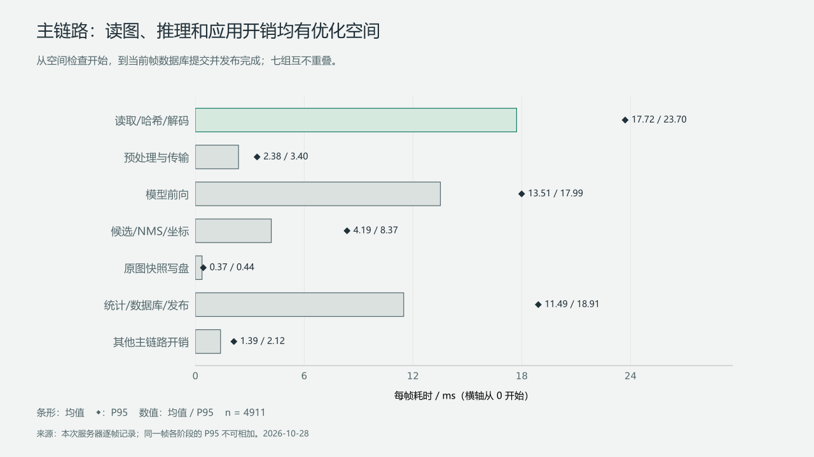
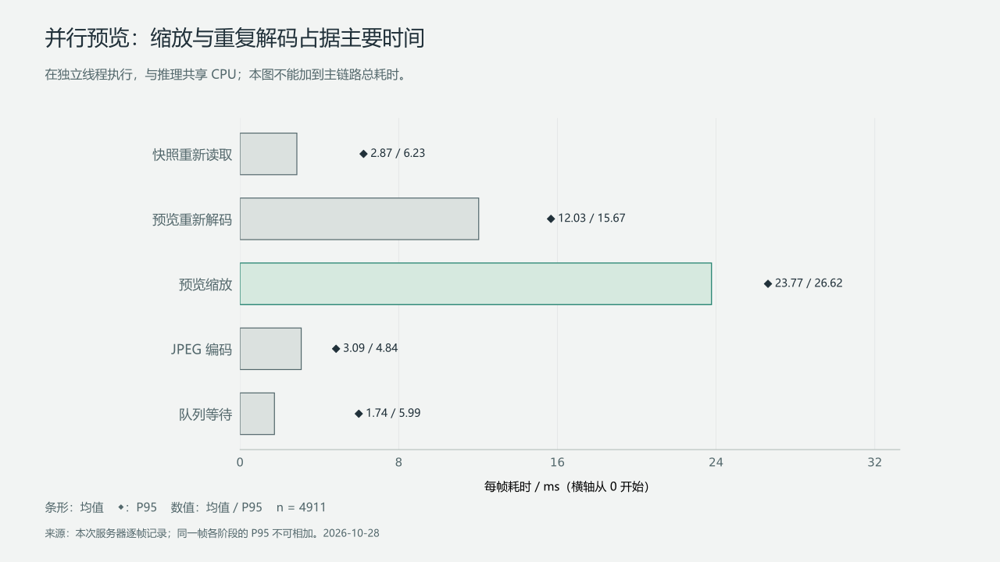

# Factory Demo · 完整 4911 张性能测试与优化依据

测试日期：2026-10-28；离线复核与报告整理：2026-10-29。状态：**两种条件均完成 4911/4911，失败 0；本轮只测量与分析，未实施性能优化。** 服务器目前已断开，以下运行状态均指测试结束时留存的证据。

## 1. 先看实际结果

|口径|处理图片|墙钟耗时|实际吞吐|包含内容|
|---|---|---|---|---|
|基线链路|4911|143.619 秒|34.195 张/秒|读图、哈希、解码、预处理、GPU前向、后处理、几何信息及CSV记录|
|完整应用链路|4911|252.907 秒|19.418 张/秒|真实API创建任务、原图快照、统计、PostgreSQL提交、结果发布；包含三次任务之间的请求/轮询间隔|
|应用worker区间|4911|251.433 秒|19.532 张/秒|三个服务端run_start到run_end区间之和，排除任务间API间隔|

应用单帧活动周期均值 **51.040 ms**，P50 **49.676 ms**，P95 **66.218 ms**，P99 **81.164 ms**。旧界面的total均值为37.151 ms，其倒数约26.92 FPS；它漏掉数据库等环节，不能当作实际应用吞吐。

两个条件同时改变了预览、ASGI、观察器等工作负载，可能伴随资源与锁竞争；没有关闭预览的配对试验，不能分离各因素的因果贡献，也不能把增加的109.288秒全部归于数据库或原图写盘。两组是不同工作负载条件，不是优化前后对照。

## 2. 固定条件与输入边界

- 服务器：Ubuntu22.04.5 / Linux5.4，RTX3080Ti 12GiB，驱动580.76.05，Toolkit12.8.93，GCC11.4。
- 独立Conda：`/root/miniconda3/envs/factory_demo/bin/python`，Python3.10.22，PyTorch2.5.1+cu124、torchvision0.20.1、NumPy1.26.4、OpenCV4.10.0.84。完整包版本在environment.json。
- 容器可见48个逻辑CPU，但cgroup配额相当于12个CPU；内存上限90GiB。不能按48核独占机器解读。
- 数据集：`/root/autodl-tmp/dataset/dataset4911_obb_622`，train2947 / val982 / test982，按划分及文件排序，保留原划分，只测性能。
- 4911张均为**1580×1080**，共1,526,260,344字节（约1.421GiB）；4911个不同SHA-256。不是规划中的4096×2168工业相机负载。
- 权重`factory_now.pt`，175,615,389字节，SHA-256：`62af01dbc971d332ad4813d5f2811243f555877ffbdb0755fe428159687ef037`。
- PyTorch / cuda:0 / FP32 / batch1 / image_size640 / confidence0.25 / IoU0.45 / max_det300；实际自动letterbox张量在trace中核实为`[1,3,448,640]`，不是固定640×640。
- 应用单进程、单任务、单帧串行推理；数据库PostgreSQL14.24在本机，synchronous_commit=on、fsync=on、track_io_timing=off。
- 保留默认replay_fps=10参数，仅在追踪开启且设置`FACTORY_BENCHMARK_UNPACED=1`时跳过回放等待。测试结束时的记录显示正式服务已撤去两个测量变量；代码保留常规10fps上限。本轮不检查服务器当前状态。

**预热与缓存**：正式计时前读取并哈希全部输入；没有清理OS缓存。基线、应用各先用前10张实际图片预热，加载及预热不计入4911张墙钟。此测试偏向已缓存文件读取，不能称为冷磁盘吞吐。每个条件只有一次完整有效测量，P95/P99描述图片混合分布，不是多轮置信区间。

## 3. 主链路：哪些环节占时间



|互斥主链路分组|样本数|均值ms|P50ms|P95ms|P99ms|最大ms|
|---|---|---|---|---|---|---|
|读取/哈希/解码|4911|17.717|17.335|23.703|27.146|250.960|
|预处理与传输|4911|2.380|2.231|3.404|4.247|7.196|
|模型前向|4911|13.513|12.457|17.995|27.781|54.338|
|候选/NMS/坐标|4911|4.186|3.631|8.365|12.559|19.892|
|原图快照写盘|4911|0.368|0.335|0.437|0.678|45.043|
|统计/数据库/发布|4911|11.488|10.464|18.913|28.763|222.068|
|其他主链路开销|4911|1.387|1.383|2.123|3.309|13.138|


总活动周期起点在空间检查前，终点在该帧提交后结果发布完成；七组均值相加等于51.040ms。各阶段P95/P99不能相加。其他开销为活动周期减去六个已测分组的逐帧差值，包含对象构造、调用、计时与部分追踪开销；没有强行归因。

|细分阶段|n|均值ms|P50ms|P95ms|P99ms|最大ms|
|---|---|---|---|---|---|---|
|文件 stat|4911|0.901|0.271|3.528|5.391|9.458|
|原图字节读取|4911|1.939|1.405|5.383|7.256|233.100|
|SHA-256|4911|1.632|1.355|3.446|5.253|8.610|
|原图解码|4911|13.245|13.161|17.032|19.114|26.527|
|letterbox|4911|1.476|1.375|2.145|2.725|5.867|
|布局/连续内存转换|4911|0.424|0.387|0.632|0.819|2.193|
|H2D/类型/归一化|4911|0.480|0.452|0.558|0.825|3.937|
|候选筛选/旋转NMS|4911|2.485|2.111|5.462|8.705|14.561|
|坐标还原/结果组装|4911|1.056|0.838|2.027|5.838|12.296|
|几何属性补充|4911|0.646|0.613|1.117|1.427|3.816|
|可用空间检查|4911|1.526|1.222|4.459|5.737|215.775|
|运行统计/复制|4911|1.412|0.824|4.891|6.948|11.250|
|数据库保存/提交|4911|6.554|5.606|11.290|21.792|127.196|
|结果发布|4911|1.997|1.760|4.147|6.041|11.361|
|单帧活动周期|4911|51.040|49.676|66.218|81.164|284.338|
|旧界面处理total|4911|37.151|35.649|49.582|59.228|269.361|


**阶段约束**：H2D/归一化含CPU→GPU传输、类型转换与归一化；nms_ms含有限性检查、候选筛选/CSL和旋转NMS，并非裸CUDA内核。数据库区间含Python序列化、应用锁、本机协议、SQL及commit，不能称服务器纯SQL耗时。原图快照使用write_bytes返回，没有fsync，0.368ms不代表磁盘持久化延迟。pacing_wait均值0.0161ms是发布后边界开销，本轮没有主动回放sleep。

## 4. 并行展示：图片和识别结果到达的延迟



|并行显示指标|n|均值ms|P50ms|P95ms|P99ms|最大ms|
|---|---|---|---|---|---|---|
|预览排队|4911|1.736|0.407|5.988|9.561|216.495|
|预览重新读取|4911|2.866|2.525|6.229|7.855|234.254|
|预览重新解码|4911|12.032|12.060|15.675|17.573|27.915|
|预览缩放|4911|23.768|23.447|26.616|29.379|37.437|
|JPEG编码|4911|3.086|2.689|4.843|6.956|215.286|
|字节打包/UUID/描述|4911|0.073|0.046|0.081|0.898|7.942|
|缓存更新/发布|4911|0.230|0.130|0.791|2.041|5.939|
|预览工作总区间|4911|42.056|41.438|49.406|54.196|275.025|
|帧处理开始→预览就绪|4911|93.224|91.758|111.656|130.160|332.330|
|DB提交→预览就绪|4911|45.707|45.014|53.643|58.866|281.921|
|WS发送开始→本机接收|4911|3.350|3.147|5.839|7.520|11.462|
|观察器等待下载|4911|0.170|0.164|0.236|0.297|2.919|
|本机JPEG HTTP接收|4911|6.760|5.648|12.359|15.664|243.766|
|本机JPEG解码|4911|5.740|5.783|8.055|8.793|9.934|
|帧处理开始→本机解码完成|4911|112.505|110.864|135.870|153.856|363.003|


本轮4911张全部产生预览，4911张均被本机观察器HTTP接收并解码，HTTP全部200，没有待处理队列替换。JPEG平均约54.61KiB，P95约61.71KiB。全程观察器计数4922还包括10张预热和启动时的旧快照；统计已按三个正式run_id过滤为4911。

观察器通过本机WS接收帧元数据，用容量1的待取队列取最新JPEG，再由Pillow解码；它是可控本机消费者，不是实际浏览器、公网HTTPS延迟或绘制耗时。WS测量事件11873次，包含状态变化和多订阅者，不能当图片数。服务端send_json均值3.408ms，P95 9.068ms，包含序列化与ASGI背压，不等于纯网络耗时；WS快照复制均值1.810ms。

“帧处理开始→本机解码完成”起点在空间检查之后，均值112.505ms、P95 135.870ms；“活动周期”起点在空间检查之前，两者边界不同。显示工作与主链路重叠，不能把42.056ms预览工作再加到51.040ms周期上。当前19.42fps下预览全覆盖，不代表42fps时仍全覆盖；latest-only策略允许显示跳帧，但检测记录必须完整。

## 5. 输入完整性、结果数量和慢帧

|划分|图片|失败|框数|worker秒|worker FPS|
|---|---|---|---|---|---|
|train|2947|0|83872|156.901|18.783|
|val|982|0|27798|46.758|21.002|
|test|982|0|27993|47.775|20.555|


两种条件各4911张，失败均0，输出均为139,663个检测框。逐图SHA-256全部对应，逐图框数、逐类框数、舍入输出签名差异均0。应用有82张成功但无检测，触及max_det300的图片0张。空检测不等于漏检，框数不是跨帧物体去重计数。

权重8类、真值7类且类别顺序不同；本轮未做类别映射、旋转IoU匹配、AP、召回率、执行成功率或模型数值容差验收。签名一致只用于排查测量链路是否改变输出。

以下为活动周期最长的15帧，全部保留在pipeline-frames.csv中。最大值用于定位，不能单凭一帧判定永久瓶颈。

|划分|相对图片路径|帧ID|框数|周期ms|读字节ms|解码ms|前向ms|空间检查ms|DBms|
|---|---|---|---|---|---|---|---|---|---|
|train|train/images/20250615_063409296_003462.jpg|968|18|284.34|233.10|14.66|13.03|4.44|6.24|
|val|val/images/20250531_223851329_000003.jpg|121|28|259.28|3.86|12.23|12.07|215.77|4.19|
|test|test/images/20250614_032627334_002181.jpg|314|29|252.91|211.22|14.51|12.41|0.06|3.28|
|train|train/images/20250614_015502972_002064.jpg|843|29|175.41|3.37|13.75|12.06|0.08|127.20|
|train|train/images/20250615_023613216_003131.jpg|937|40|171.48|0.75|14.09|12.72|3.78|123.40|
|val|val/images/20250702_005116972_000195.jpg|790|20|147.48|4.40|10.22|12.33|0.04|108.54|
|val|val/images/20250531_211137965_000146.jpg|114|0|145.52|1.78|11.69|13.12|3.47|108.68|
|train|train/images/20250621_024505356_001565.jpg|1430|43|143.81|0.53|14.49|14.09|1.81|84.44|
|val|val/images/20250531_212615099_000160.jpg|115|40|135.17|1.16|9.27|12.52|0.18|97.53|
|test|test/images/20250703_030931459_001730.jpg|865|13|132.72|0.39|13.60|14.06|1.34|90.40|
|train|train/images/20250620_180357183_000525.jpg|1328|19|125.34|0.37|14.96|12.85|2.43|77.30|
|test|test/images/20250729_213533034_000024.jpg|980|54|122.28|0.75|9.58|18.70|0.66|76.09|
|test|test/images/20250729_224336519_000129.jpg|981|35|119.21|1.25|11.64|12.24|0.18|79.33|
|train|train/images/20250602_192539527_000288.jpg|457|37|115.27|0.59|13.96|12.94|0.09|66.47|
|test|test/images/20250614_050628403_002325.jpg|320|48|114.69|8.75|15.08|12.25|5.18|52.52|


本轮有**22帧活动周期超过100ms**。在读字节、解码、前向、空间检查、数据库、快照、统计及发布这些已列区间中，19帧最大的区间是DB提交，2帧是读字节，1帧是空间检查。最长帧284.338ms中，读字节占233.100ms；另有259.283ms帧的空间检查占215.775ms。它们是下一轮补充IO/锁/commit追踪的定位线索，尚不能据此判定磁盘设备慢或SQL本身慢。

### 共同阶段为什么在应用中也变慢

|共同阶段|基线均值ms|应用均值ms|差值ms|
|---|---|---|---|
|原图字节读取|0.176|1.939|+1.763|
|SHA-256|0.804|1.632|+0.828|
|原图解码|9.189|13.245|+4.056|
|预处理|2.201|2.380|+0.179|
|模型前向|12.169|13.513|+1.344|
|后处理|2.742|3.540|+0.798|
|几何补充|0.562|0.646|+0.084|


应用解码比基线增加4.056ms，前向增加1.344ms；这说明完整应用的附加成本不限于新增的DB和快照区间，已有阶段的墙钟分布也发生变化。并行预览、WS序列化与主线程共享CPU/锁，可能参与竞争；但没有“相同服务关闭预览”的配对实验，不能证明全部差值由预览导致，也不能把这些差值再重复加到主链路均值。

有限目录模式每帧从增长的耗时列表计算分位数，连续inbox模式使用上限1000的deque，两种模式边界不同。从本轮各划分首尾20%窗口看，统计/复制并不一致地随帧号增长（train为1.682→1.641ms，val为0.668→1.213ms，test为0.981→0.936ms）。可列为源码层面的候选改进，尚无证据称其为本轮持续恶化的首要瓶颈；窗口数据保存在additional-analysis.json。

## 6. 资源与存储记录

|资源（均值 / 采样最大）|基线|应用链路|
|---|---|---|
|进程CPU %|100.03 / 100.74|177.60 / 191.48|
|进程RSS MiB|1426.80 / 1427.30|1426.05 / 1428.44|
|整卡GPU利用率 %|39.89 / 46.00|24.85 / 39.00|
|GPU显存 MiB|911.00 / 911.00|911.00 / 911.00|
|GPU功率 W|211.33 / 218.58|131.02 / 139.05|
|GPU温度 ℃|63.24 / 68.00|54.57 / 59.00|


每2秒采样一次：基线70点、应用123点。CPU100%表示一个逻辑CPU，177.6%约1.78个核；只监控推理/API进程，不含数据库、网关和独立观察器。GPU指标为整卡采样，最大值不是瞬时峰值；未达到100%不能独立证明GPU利用率可按比例放大。

应用轮次数据库体积增加约30.06MiB，文件系统空闲减少约1.468GiB。包含预热、数据库WAL、原图快照和测量日志，不能视为纯业务净增长。各阶段资源原始采样在raw-records.tar.gz，/proc读取中read_bytes增量为0，与已预热页缓存一致，不代表没有读图。

追踪record调用累计：基线396.508ms、应用3524.942ms；该累计横跨线程、含锁等待，线程间可重叠，**不能从墙钟直接扣除**。CUDA计时增加了一处NMS后同步，其扰动没有通过开/关追踪配对试验定量；报告数据属于带测量仪器的基线。

## 7. 后续优化优先级（本轮只分析）

|优先级|证据与建议实验|验收约束|
|---|---|---|
|P0 输入与预览图像处理|主链路解码13.245ms；预览重复解码12.032ms、INTER_AREA缩放23.768ms。优先对比缩放策略/实现；再评估有界预览任务复用已解码图像，减少重复读取与解码。|保持原图/结果绑定、坐标变换、JPEG尺寸与质量可解释；限制队列和内存。变更线程数需整链路复测，不能只测单次resize。|
|P0 应用同步区间|统计/DB/发布11.488ms，其中DB6.554ms；空间检查均值1.526ms、最大215.775ms。拆出JSON编码、锁等待、SQL、commit及文件系统检查慢点，检查是否每帧重复计算可缓存统计。|先保留当前提交后发布语义；数据库故障策略待用户确认，不能直接将数据库改成无保障异步写。不得通过删结果/关fsync伪造提速。|
|P1 GPU前向|前向13.513ms，GPU应用轮次平均24.85%；对比FP16或TensorRT的单帧延迟及整链路吞吐，检查主机等待。|同权重/输入/阈值做OBB结果与精度对照，TensorRT尚未适配，不预估确定倍数。大batch可能增加动作等待，不能只追求离线FPS。|
|P1 有界读取流水线|当前串行读图和GPU执行；在生产落盘约束下试验完成文件发布后有界预读、解码、队列排队时间。|处理部分写入、乱序、重复文件、重启恢复和背压；明确超时帧如何处置，不能静默丢执行帧。实时积压不能靠无限队列解决。|
|P2 展示传输|本机HTTP均值6.760ms、WS本机传播3.350ms，当前图像处理更大。后续在真实公网/局域网测图片体积、带宽、接收/解码/绘制。|HTTP用于不可变JPEG、WS用于元数据是当前实现；不能据此认定HTTP必须全部改WS，也不能用本机结果承诺公网延迟。|
|P2 持续运行与动作时限|测试有效运行仅约4.2分钟；尚无真实相机、编码器和执行反馈。补持续落盘、磁盘空间、WAL增长与长尾关联监测。|冻结相机像素格式、接口、存图格式、曝光完成时间；补拍摄到动作距离、编码器和实际动作延迟，建立逐帧截止时间。|

串行简化估算：如果其他均值完全不变，模型前向耗时理想降为0，周期仍需37.528ms，对应约26.65fps；仅将读图/哈希/解码理想降为0，仍约30.01fps。**这只是固定其余开销的上限算术，不是可实现的优化预测**；真正并行化会改变资源竞争与阶段时间。

42fps对应每帧23.810ms预算。本轮所有4911帧活动周期都超过这一参考值，离线应用能力19.418fps低于42fps：**只在同类1580×1080工作负载、持续输入42fps且长期处理能力固定19.418fps的假设下**，积压约增加22.582帧/秒，即每分钟约1355帧。19.418fps来自有限目录三次任务的场景吞吐，不是连续工业相机服务率的实测；持续inbox还使用不同统计窗口。这是排队算术示例，不是工业相机实测。生产相机4096×2168与本轮输入不同，不能直接外推具体现场FPS。带速0.45m/s下，51.040ms约对应2.30cm、112.505ms约5.06cm，只是恒速距离换算；没有拍摄到执行距离/编码器/动作延迟，无法给出合格动作截止时间。

## 8. 复现、文件与测量审计

先确认无活动任务、磁盘空间和数据库备份策略。脚本针对本台Linux部署，会核对PID和目录、停止8765主服务、启动带追踪实例；6006只读入口继续运行，最后恢复正常8765。不是通用生产压测工具，不能在有业务时直接运行。

```bash
conda activate factory_demo
cd /root/autodl-tmp/factory_demo
# 必须使用全新目录，避免追踪追加和原始记录混合
python -B scripts/benchmark_full4911.py --dataset /root/autodl-tmp/dataset/dataset4911_obb_622 --output /root/autodl-tmp/tmp/bench4911-NEW
python -B scripts/analyze_benchmark.py --input /root/autodl-tmp/tmp/bench4911-NEW --output /root/autodl-tmp/tmp/bench4911-NEW/analysis
```

`--phase pipeline`仅适用于已准备manifest、warm_images和配置的受控重测；不要把它当首次运行入口。本次复用完整基线CSV，补跑应用链路。

服务器断开后，在含NumPy/Pandas/Matplotlib/Markdown的本机Conda环境中，可不加载模型、不连接数据库地复算补充分析与生成网页：

```text
python -B docs/benchmarks/20261028-full4911/analyze_records.py
python -B docs/benchmarks/20261028-full4911/build_report.py
```

本报告生成在用户指定的yolo_v5_obb环境中，图表使用本机微软雅黑；其他机器重新生成时需提供可用中文字体或修改FONT路径。已经生成的HTML/SVG均已内嵌图形字形，离线阅读不需要Python或安装字体。

第一轮应用4911张均成功入库，但SIGTERM时Uvicorn重新发送信号，atexit没能保证追踪尾部落盘，丢失最后2帧周期。该轮保留在`/root/autodl-tmp/tmp/bench4911-20261028-01`，**没有用它计算最终分位数**。最终应用轮次在`/root/autodl-tmp/tmp/bench4911-20261028-02`；lifespan显式关闭追踪，原始文件有完整footer。观察器也改为独立接收、只取最新帧，避免其自身积压污染显示延迟。

基线与应用各自的实测源码哈希、源码副本分开留存。基础Git版本277d7f5；在其上增加测量点。测量完成后仅加固了复现脚本的异常恢复顺序、统计完整性断言与文档，不改变这次实测样本。测试记录probe-tests.log：服务器63通过、9个subtests，另有2条警告；本机59通过、4项CUDA跳过。逐图性能不是这些测试的耗时。

|交付文件|用途|
|---|---|
|[report.html](report.html)|独立离线网页版，内嵌SVG图，方便阅读|
|[summary.json](summary.json)|全量统计、环境、恢复状态、资源与口径|
|[pipeline-frames.csv](../../docs/benchmarks/20261028-full4911/pipeline-frames.csv)|4911行应用逐帧计时、哈希核对与预览对应|
|[baseline-frames.csv](../../docs/benchmarks/20261028-full4911/baseline-frames.csv)|4911行基线逐帧计时|
|[stage-statistics.csv](stage-statistics.csv)|所有阶段n、均值、P50/P90/P95/P99/最小/最大/累计|
|[manifest.jsonl](../../docs/benchmarks/20261028-full4911/manifest.jsonl)|输入相对路径、尺寸、字节、哈希与划分|
|[raw-records.tar.gz](../../docs/benchmarks/20261028-full4911/raw-records.tar.gz)|原始追踪/资源/本机观察器/实测源码快照；不含原图、权重、密码|
|[archive-integrity.json](../../docs/benchmarks/20261028-full4911/archive-integrity.json)|压缩归档及权重的SHA-256和白名单|
|[attempt-audit.json](../../docs/benchmarks/20261028-full4911/attempt-audit.json)|首次不完整记录与补跑原因|
|[restoration.json](../../docs/benchmarks/20261028-full4911/restoration.json)|正常服务恢复证据|
|[additional-analysis.json](additional-analysis.json)|共同阶段对照、长尾定位、分段统计和排队算术假设|
|[offline-verification-20261029.json](offline-verification-20261029.json)|本地归档与源码哈希、4911帧对应及逐阶段统计复算结果|

测试结束时的留存证据显示：正式服务健康检查OK、active_run_id为空；云端配置恢复configs/cloud.json、cuda:0，FACTORY_TRACE_PATH和FACTORY_BENCHMARK_UNPACED均未设置，公开6006预览就绪。**2026-10-29服务器已断开，本次没有重新检查在线状态**。测试记录未执行自动清理；实例存储在断开/释放后的存续取决于平台与用户操作，不能据离线文件保证当前服务器仍保留原图或数据库。
